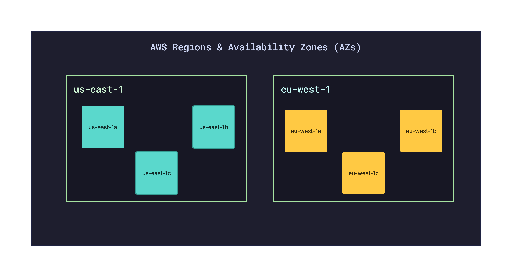

> AWS global infrastructure is built around Regions and Availability Zones (AZs)

[Regions and Availability Zones](https://aws.amazon.com/about-aws/global-infrastructure/regions_az/)




### Regions

**AWS Regions** are physically isolated geographic areas where AWS clusters data centers, designed to address data residency, compliance, and latency requirements.

### Availability Zones (AZs)

**Availability Zones (AZs)** are distinct, physically separate locations within a single region, each containing one or more data centers with independent power and networking, designed to provide fault tolerance and high availability.


### AWS CLI Example

```bash
aws ec2 describe-availability-zones --region us-east-1
```

```json
{
    "AvailabilityZones": [
        {
            "Messages": [],
            "RegionName": "us-east-1",
            "ZoneName": "us-east-1a",
            "ZoneId": "us-east-1-az1",
            "ZoneType": "availability-zone",
            "State": "available"
        },
        {
            "Messages": [],
            "RegionName": "us-east-1",
            "ZoneName": "us-east-1b",
            "ZoneId": "us-east-1-az2",
            "ZoneType": "availability-zone",
            "State": "available"
        },
        {
            "Messages": [],
            "RegionName": "us-east-1",
            "ZoneName": "us-east-1c",
            "ZoneId": "us-east-1-az3",
            "ZoneType": "availability-zone",
            "State": "available"
        }
    ]
}
```

