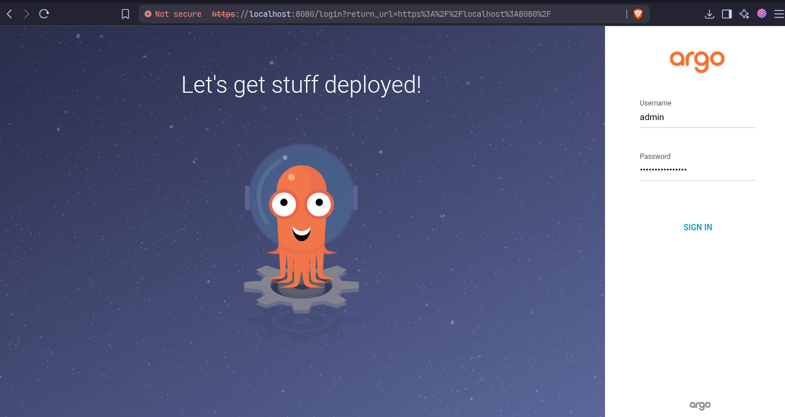
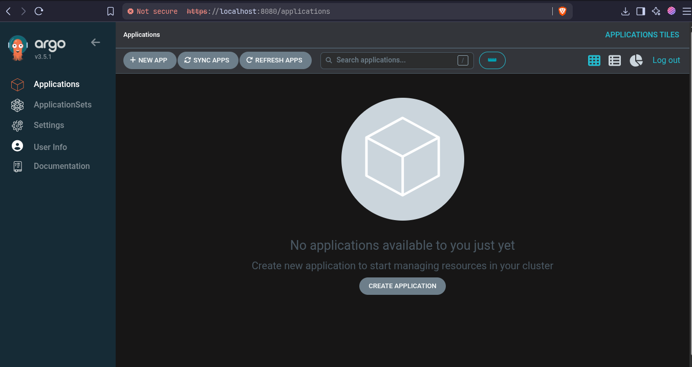
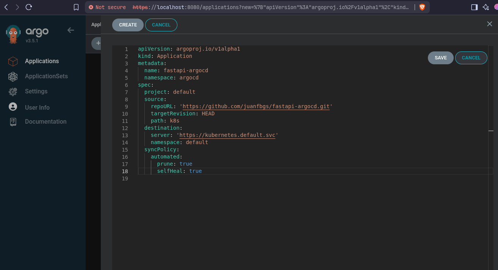
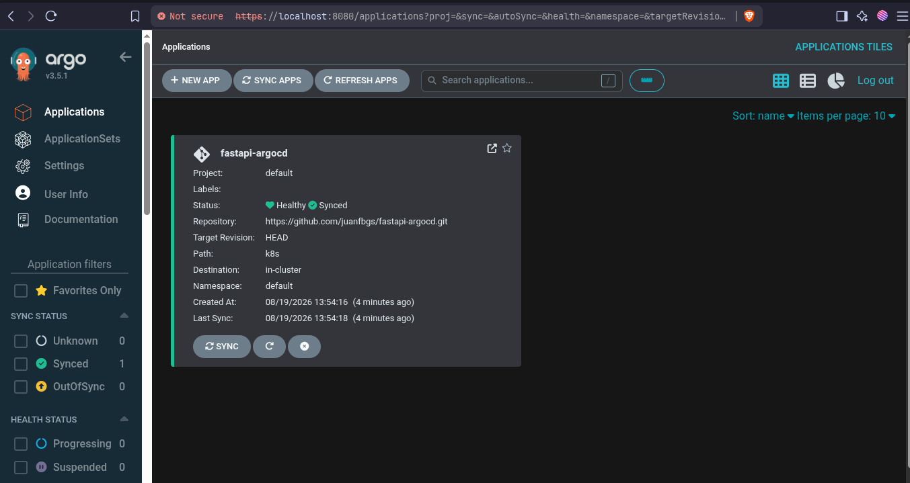
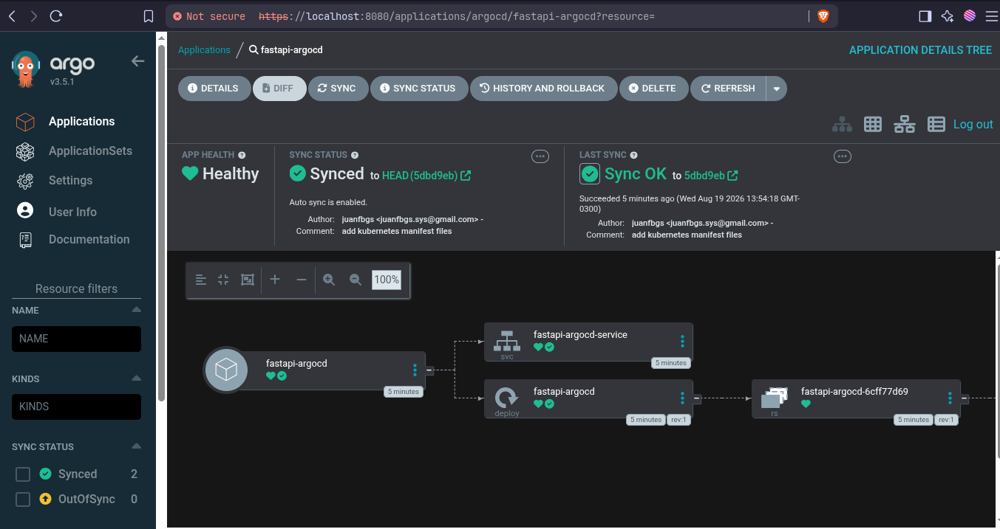
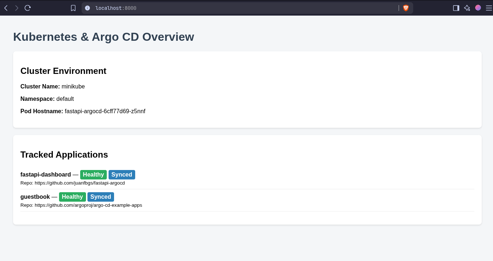

> *Argo CD* is a declarative, GitOps continuous delivery (CD) tool built specifically for Kubernetes. It automates the deployment of applications by keeping your live Kubernetes cluster in sync with configuration files stored in a Git repository.


### Download tools

[Docker](https://www.docker.com/get-started/)

[kubectl](https://kubernetes.io/docs/tasks/tools/#kubectl)

[Minikube](https://minikube.sigs.k8s.io/docs/)

### Start Kubernetes cluster with Minikube

```bash
minikube start
```

### Create `argocd` namespace

> A Kubernetes **namespace** is a mechanism for isolating groups of resources within a single cluster, providing a scope for names and enabling logical organization for multiple users, teams, or projects.

```bash
kubectl create namespace argocd
```

```bash
> kubectl get namespaces
NAME              STATUS   AGE
argocd            Active   80s
```

### Apply the official installation manifest

```bash
kubectl apply -n argocd --server-side --force-conflicts -f https://raw.githubusercontent.com/argoproj/argo-cd/stable/manifests/install.yaml
```

### Wait for all pods to be in the Running state

```bash
kubectl get pods -n argocd --watch
```

```bash
NAME                                                READY   STATUS    RESTARTS      AGE
argocd-application-controller-0                     1/1     Running   0             2m34s
argocd-applicationset-controller-5869fbf6cf-whxsx   1/1     Running   0             2m36s
argocd-dex-server-7d55bfc58-rjckn                   1/1     Running   1 (88s ago)   2m36s
argocd-notifications-controller-76574f7fcd-6c6rq    1/1     Running   0             2m35s
argocd-redis-78c4b6647d-blgx9                       1/1     Running   0             2m35s
argocd-repo-server-95fccf577-vv9hd                  1/1     Running   0             2m35s
argocd-server-7985c69556-5r5zq                      1/1     Running   0             2m35s
```

### Expose the Argo CD UI

Forward port 8080 on your machine to the argocd-server service

```bash
kubectl port-forward svc/argocd-server -n argocd 8080:443
```

### Log in Using The CLI

[Download Argo CD CLI](https://github.com/argoproj/argo-cd/releases/tag/v3.5.1)

[argocd CLI docs](https://argo-cd.readthedocs.io/en/stable/getting_started/#2-download-argo-cd-cli)

#### Retrieve this password using the argocd CLI

```bash
argocd admin initial-password -n argocd
```

username: `admin`


*Login*




*Dashboard*




### Create demo app via Dashboard

Press `EDIT AS YAML`







### Port Forwarding via CLI

```bash
> kubectl port-forward svc/fastapi-argocd-service 8000:80
Forwarding from 127.0.0.1:8000 -> 8000
Forwarding from [::1]:8000 -> 8000
Handling connection for 8000
```



