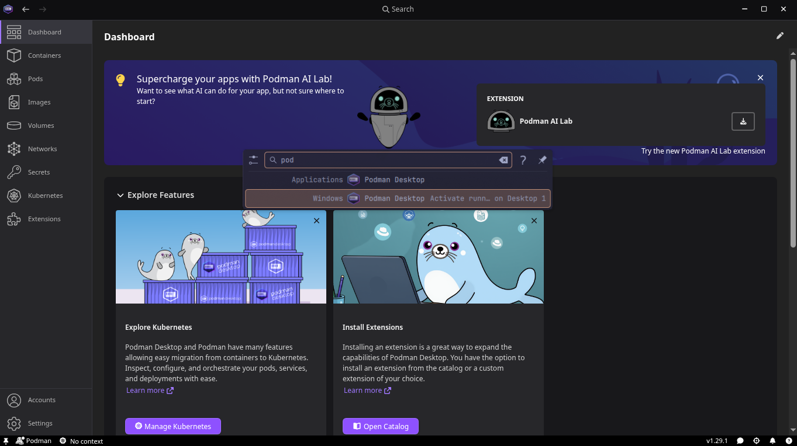
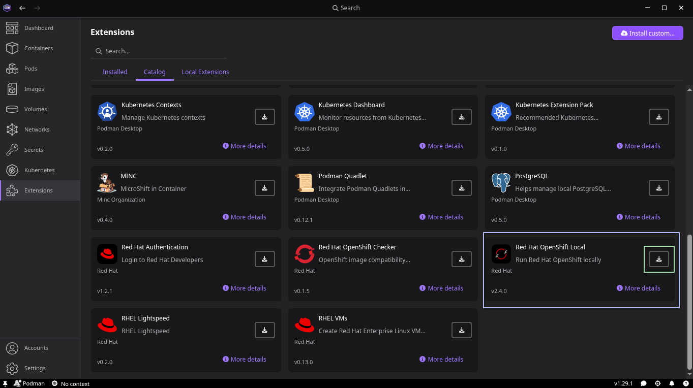
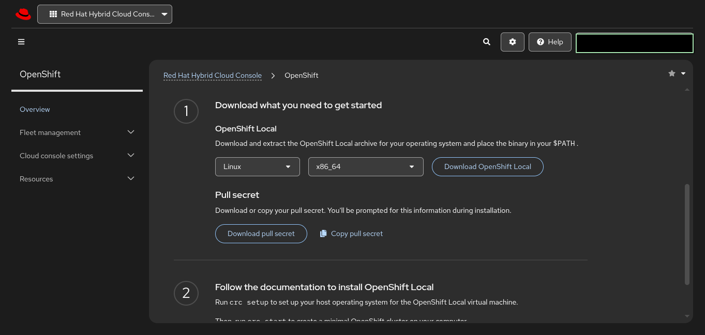

> OpenShift Local is a tool designed to run an OpenShift cluster directly on your local machine.


### Install Podman Desktop

#### Install the Podman Engine

```bash
sudo apt update && sudo apt install -y podman
```

#### Download and Extract Podman Desktop

*Download the latest Linux tarball*

[Podman Desktop for Linux](https://podman-desktop.io/downloads/linux)


```bash
# Move to the folder where you downloaded the file
cd ~/Downloads

# Extract the archive to /opt
sudo tar -xzf podman-desktop-*.tar.gz -C /opt

# Rename the extracted folder for easier referencing
sudo mv /opt/podman-desktop-* /opt/podman-desktop
```

#### Download logo

```bash
wget https://podman-desktop.io/img/logo.svg
```

```bash
sudo cp logo.svg /opt/podman-desktop/resources/podman-desktop.svg
```

#### Add to Your Application Launcher Menu

*create a `.desktop` file*

Location: `~/.local/share/applications/podman-desktop.desktop`

```bash
[Desktop Entry]
Name=Podman Desktop
Comment=Manage Podman and other container engines
Exec=/opt/podman-desktop/podman-desktop %U
Terminal=false
Type=Application
Icon=/opt/podman-desktop/resources/podman-desktop.svg
Categories=Development;IDE;
StartupWMClass=Podman Desktop
```




### Register a Red Hat account

[Register](https://developers.redhat.com/register)

### Install the OpenShift Local extension



### Install the OpenShift Local binary

[Download](https://console.redhat.com/openshift/create/local)



```bash
tar -xvf crc-linux-amd64.tar.xz
```

```bash
sudo mv crc-linux-2.63.0-amd64/crc /usr/local/bin
```

### Configure your system

```bash
crc setup
```

```bash
Your system is correctly setup for using CRC. Use 'crc start' to start the instance.
```

